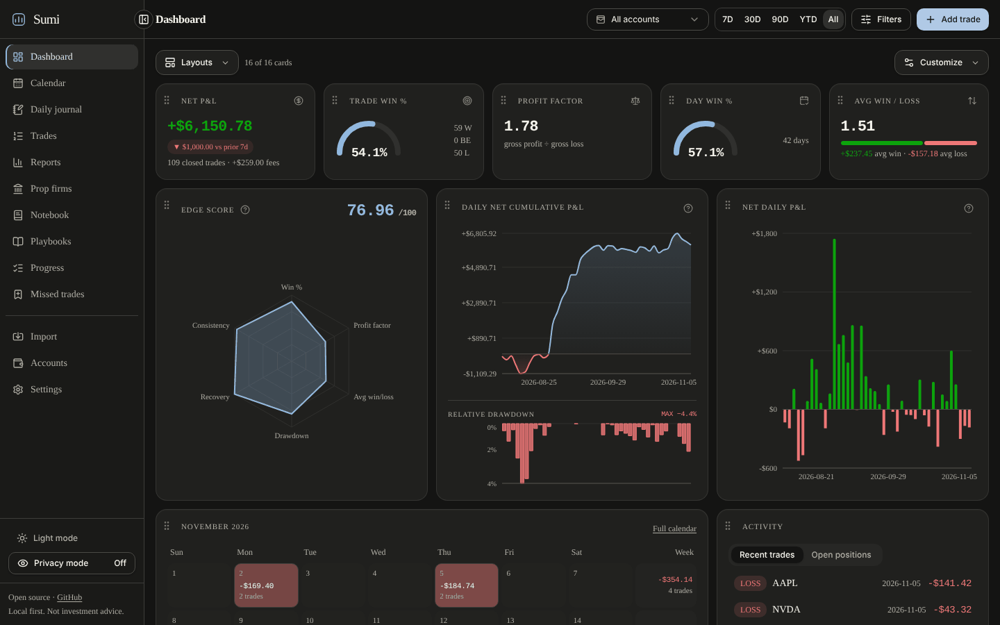
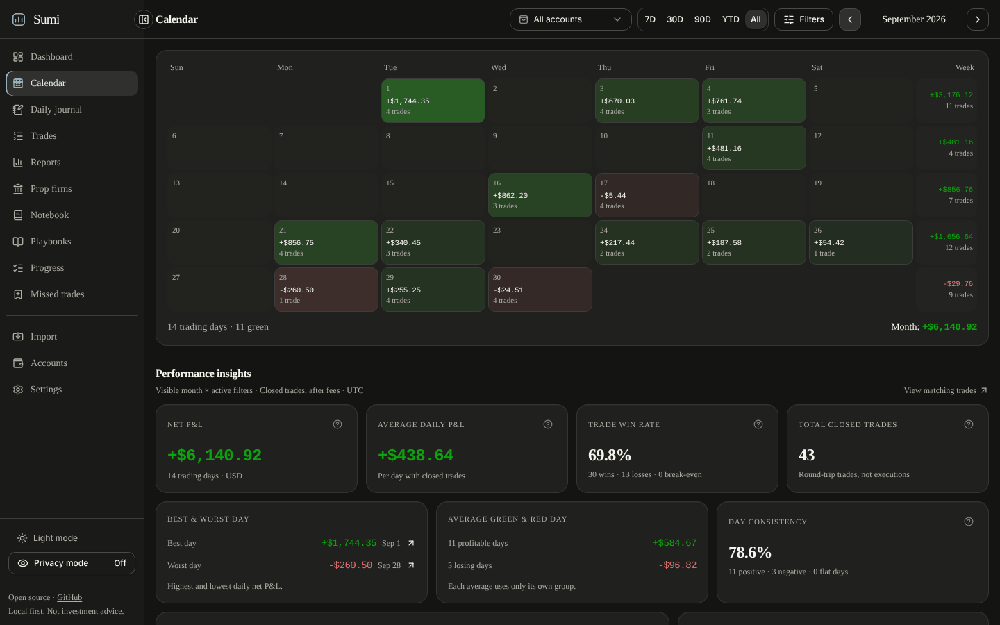
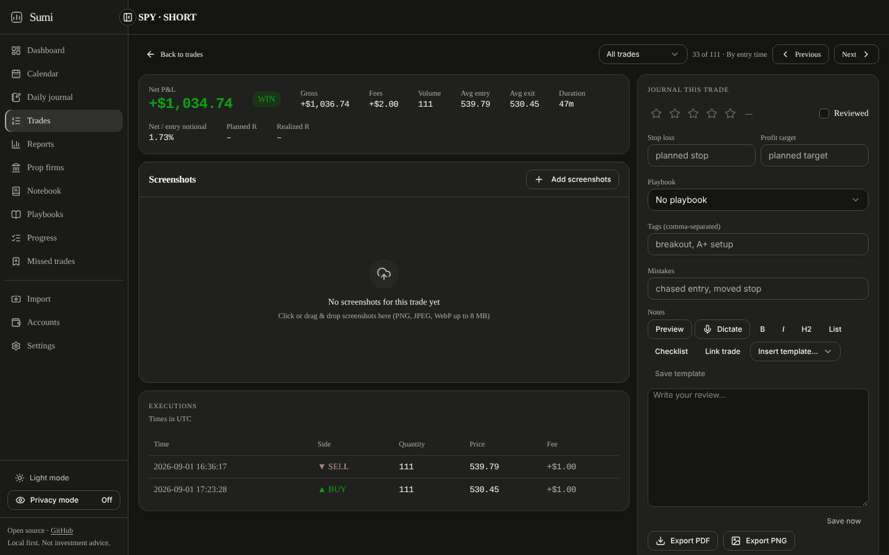
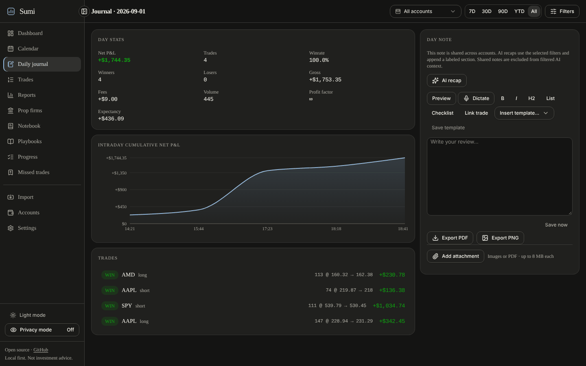
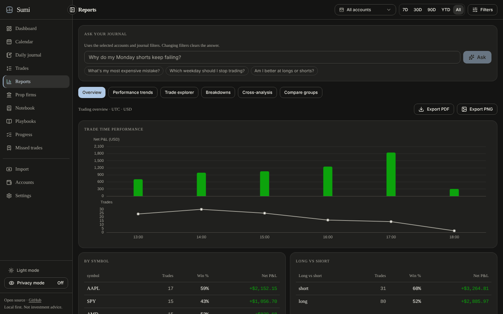
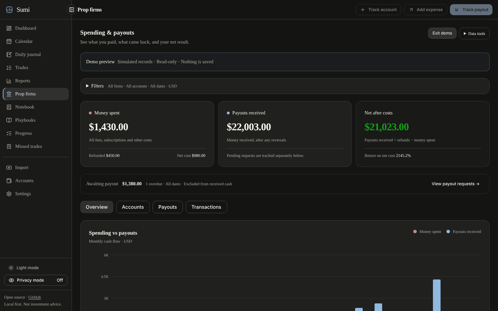

# Sumi

Sumi is a local-first desktop trading journal for macOS, Windows and Linux. Your trades, notes and attachments live in a SQLite database on your own machine. Sumi imports broker statements or syncs read-only from supported brokers, rebuilds your fills into round-trip trades, and gives you analytics, a daily journal, prop firm cost tracking and optional AI reflection.

Sumi is based on [LuxAlgo's open-source trade-journal](https://github.com/LuxAlgo/trade-journal) (MIT). See [Attribution and license](#attribution-and-license).



## Features

- **Broker sync**: read-only sync through [`@luxalgo/broker-sdk`](https://github.com/LuxAlgo/broker-sdk) for Alpaca, Binance, Bybit, Coinbase, Kraken, OKX, Tradier, IBKR Flex, Hyperliquid, Questrade, Topstep, Trading212, Webull, Crypto.com, E\*TRADE, Public, Charles Schwab, TradeStation, tastytrade, Robinhood Crypto, Gemini and KuCoin.
- **Statement import**: auto-detected file formats (TradeZella, Tradervue, TradingView, MetaTrader 4/5, ThinkorSwim, IBKR, NinjaTrader, Tradovate, TopstepX, Webull, DAS Trader, XTB, Hyperliquid and others) plus a column mapper for any other CSV. See [docs/importers.md](docs/importers.md) for the full list and validation status.
- **Round-trip engine**: flat-to-flat trades built from raw fills, with FIFO, LIFO or weighted-average matching per account.
- **Analytics**: P&L, win rate, profit factor, expectancy, R multiples, drawdown, per-symbol/tag/mistake/playbook breakdowns, advanced filters, comparison groups, rolling [performance trends](docs/performance-trends.md), a [trade explorer](docs/trade-explorer.md) and the documented [Edge Score](docs/edge-score.md).
- **Dashboard and calendar**: customizable, saveable card layouts, a P&L calendar with weekly totals and [calendar insights](docs/calendar-insights.md).
- **Daily journal and notebook**: Markdown notes with templates and image/PDF attachments, playbooks with rule checklists, routines and a missed-trade log.
- **Offline voice dictation**: dictate notes with on-device speech recognition (see [below](#offline-voice-dictation)).
- **AI reflection (optional)**: session recaps, trade critiques and "ask your journal", using your own Anthropic or OpenAI key or an OpenAI-compatible server. Configure it in **Settings → AI**. See [docs/ai-scope.md](docs/ai-scope.md).
- **Prop firm tracker**: evaluation and reset costs, refunds, payout requests and receipts, cash ROI and renewal reminders, kept separate from trade P&L. See [docs/prop-firms.md](docs/prop-firms.md).
- **Market data for MAE/MFE (optional)**: estimated maximum adverse and favorable excursion for closed trades. See [below](#market-data).
- **Export and privacy**: privacy mode masks monetary values; trades export to CSV, reviews to PDF or PNG, and journal records to JSON.

## Screenshots

Captured from the app with generated demo data and fictional prop firm records.

<details>
<summary><strong>Calendar</strong></summary>

</details>

<details>
<summary><strong>Trade detail</strong></summary>

</details>

<details>
<summary><strong>Daily journal</strong></summary>

</details>

<details>
<summary><strong>Reports</strong></summary>

</details>

<details>
<summary><strong>Prop firms</strong></summary>

</details>

## Install

Sumi ships as a desktop app:

| Platform | Architectures                | Packages                  | In-app updates                             |
| -------- | ---------------------------- | ------------------------- | ------------------------------------------ |
| macOS 14 | Apple Silicon (arm64), Intel | `.dmg`, `.zip`            | Sparkle                                    |
| Windows  | x64 (10/11)                  | NSIS `.exe`, portable zip | electron-updater                           |
| Linux    | x64 (glibc 2.35+)            | `.deb`, `.AppImage`       | electron-updater (not for unpacked builds) |

Release builds are produced by CI from `electron-v*` tags and published to this repository's [GitHub Releases](https://github.com/xolah88457/trade-journal/releases). Builds are not code-signed, so macOS Gatekeeper and Windows SmartScreen show a first-launch warning. Build steps, first-launch instructions, data locations, backups and the update system are documented in **[desktop/README.md](desktop/README.md)**.

## Develop

Requirements: Node 22+ and pnpm 11.0.8 (pinned in `package.json`). Desktop builds additionally pin Node 26.13.0; see [desktop/README.md](desktop/README.md).

```bash
git clone https://github.com/xolah88457/trade-journal
cd trade-journal
pnpm install --frozen-lockfile
pnpm dev   # web app at http://localhost:3000
```

The first run creates a SQLite database in `apps/web/data/` and applies schema upgrades automatically. On an empty dashboard choose **Load demo data** for about 90 days of generated trades, or import [`docs/samples/demo-trades-tradingview.csv`](docs/samples/demo-trades-tradingview.csv) from **Import → File upload**. `pnpm preview` builds and serves the production web app instead.

```bash
pnpm test          # vitest across packages and the app
pnpm typecheck     # all workspaces
pnpm format:check  # prettier
pnpm desktop:build # build the desktop app (see desktop/README.md)
```

When running the web app directly, these optional environment variables apply (set them in the shell or `apps/web/.env.local`; see [`.env.example`](.env.example)):

| Variable                                 | Effect                                                                |
| ---------------------------------------- | --------------------------------------------------------------------- |
| `JOURNAL_DATA_DIR`                       | Database, attachments and key directory (default `./data` of the app) |
| `JOURNAL_PASSWORD`                       | Require a password to open the web app                                |
| `JOURNAL_SECRET`                         | Encryption key source for credentials at rest                         |
| `ANTHROPIC_API_KEY` / `OPENAI_API_KEY`   | AI keys via the environment instead of Settings                       |
| `ANTHROPIC_BASE_URL` / `OPENAI_BASE_URL` | Route AI requests through a gateway or proxy                          |

The desktop app starts its backend with a restricted environment (only `JOURNAL_DATA_DIR` among these); enter AI and market-data keys in Settings.

## How it works

A raw **execution** (fill) is the one primitive. Executions arrive from broker sync, statement imports or manual entry; the round-trip engine turns them into trades; every screen reads from there.

```text
broker sync / statement import / manual entry
        -> executions (deduplicated fills)
        -> round-trip engine (FIFO / LIFO / WAVG)
        -> dashboard, calendar, journal, reports, Edge Score, AI reflection
```

## Market data

Market data is optional and used only for the MAE/MFE excursion estimates of closed trades in **Reports → Trade explorer**. Opening a trade or Reports never contacts a provider by itself.

Configure a source in **Settings → Market data**: London Strategic Edge, Alpaca or OANDA (free API keys are available), the public Binance or Coinbase endpoints (no key), or upload local candle CSV files. Keys are encrypted at rest. MAE/MFE are estimates from observed candles and executions, not tick-perfect values. Provider setup, the CSV schema, calculation definitions and limits are in [docs/market-data.md](docs/market-data.md).

## Offline voice dictation

The **Dictate** button in note editors transcribes speech on your machine; no audio is sent to a cloud service. It uses [`transcribe-cpp`](https://www.npmjs.com/package/transcribe-cpp) with the Parakeet Unified EN 0.6B speech model and a Silero voice-activity-detection model. The small VAD model is bundled in [`models/`](models). The large speech model (about 700 MB) is not bundled; Sumi downloads it on request into the data folder under `voice/`. See [desktop/README.md](desktop/README.md) for platform details.

## Monorepo layout

| Path                                       | What it is                                                                                 |
| ------------------------------------------ | ------------------------------------------------------------------------------------------ |
| [`apps/web`](apps/web)                     | The app: Next.js 15, SQLite (Drizzle), Tailwind, Recharts, TanStack Table, ai-sdk          |
| [`packages/core`](packages/core)           | Private workspace package: pure domain engine (round trips, metrics, calendar, Edge Score) |
| [`packages/importers`](packages/importers) | Private workspace package: statement parsers and migration importers                       |
| [`desktop`](desktop)                       | Electron shell, packaging, update and verification scripts                                 |

## Disclaimer

Sumi reports and analyzes what your broker reports. Nothing it computes or generates, including AI output, is investment advice, and no metric predicts future results. Verify important numbers against your broker's statements.

## Attribution and license

Sumi is an independent project based on [LuxAlgo's open-source trade-journal](https://github.com/LuxAlgo/trade-journal), which is released under the MIT license. Sumi is not affiliated with or endorsed by LuxAlgo. Its visual style is inspired by Tw93's Kami. Sumi's additions and the original code are distributed under the [MIT License](LICENSE), which retains the original copyright notice (© LuxAlgo Global, LLC). The LuxAlgo name and marks are covered by the [trademark policy](TRADEMARKS.md). Third-party licenses are listed in **Settings → About & licenses** and in [desktop/THIRD-PARTY-NOTICES.md](desktop/THIRD-PARTY-NOTICES.md). Security reports: see [SECURITY.md](SECURITY.md).
